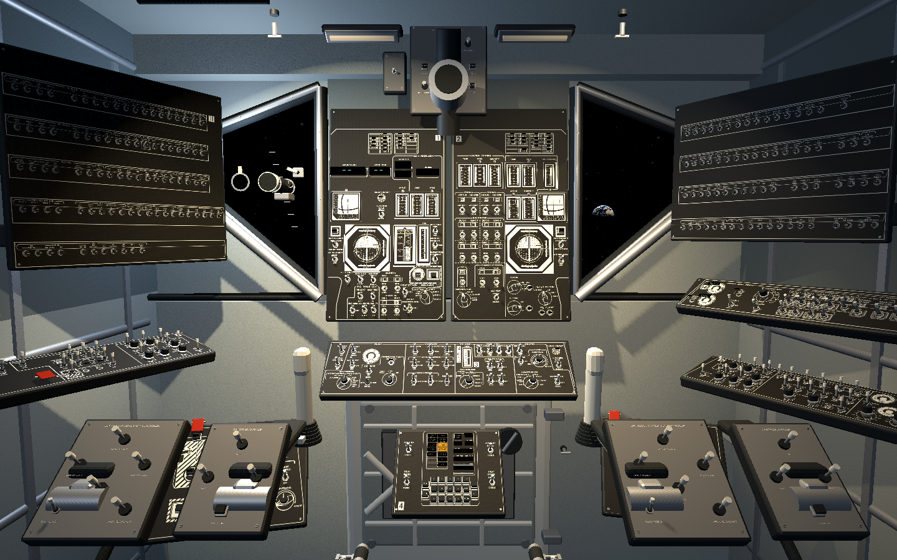

# Aquarius

A working Apollo 13 LM-7 cabin prototype with sourced panels, operable controls,
a deterministic electrical core and the real LM131R1 guidance computer.



[DSKY lamp test](output/aquarius-graphics-dsky-detail.png) ·
[Power-down](output/aquarius-graphics-power-down.png) ·
[Portable lamp](output/aquarius-graphics-utility-lamp.png) ·
[Staged COAS view](output/aquarius-graphics-coas-earth.png) ·
[Aft crew stowage](output/aquarius-aft-crew-stowage.png) ·
[Aft ECS close-up](output/aquarius-aft-ecs-detail.png) ·
[Hammocks deployed](output/aquarius-aft-hammocks.png)

## Start on this machine

Double-click **Launch Aquarius.cmd** for desktop or **Launch Aquarius VR.cmd**
with a connected OpenXR headset. The launchers build the C# bridge offline,
then open the Aquarius main menu. Enter the cabin or choose a mission chapter.
Cabin audio and mission radio are enabled in normal play. **Audio mix** on the
main or pause menu provides Headphones, Speakers and Quiet cabin profiles,
independent cabin/radio switches and saved level controls. **Play sound check**
auditions the mix while the real cabin stays paused. Automated tests and
captures start with cabin sounds muted. Reference libraries and build tools
are under `D:\apollo-ref`.

Press **Esc** on desktop or **B/Y** in VR to open the flight menu. The menu
pauses cabin activity and provides checkpoint, audio, HUD, and checklist
controls. In VR, aim either controller at the menu and select with the trigger.
Use the controller **Menu** button to recenter.
In VR, **Floating info → OFF** hides the small status window while leaving the
notebook available. **Audio mix → Test Houston voice** plays a recording
immediately. Orientation, water checkout and power-down have no spoken narrator;
Houston dialogue begins in the currently desktop-only CO₂ chapter.

The [crew flight notebook](docs/FLIGHT-NOTEBOOK.md) gives one instruction at a
time and highlights the relevant panel and control with a glow and particles.
In VR, grip near any part of the book, or aim and grip within 1.2 m, to move it;
release to float. **X** recalls
the book; **A** reveals the next target. **N** opens it on desktop.
Its default cabin checkout walks through using the water dispenser.

| Key | Action |
|---|---|
| **Esc** | Open the flight menu or return to the cabin |
| **1 / 2 / 3 / 4** | Forward cabin / DSKY close-up / electrical panel / aft cabin |
| **F2** | Powered electrical checkout |
| **F3** |12 A lifeboat calibration case |
| **F4** | Cold and dark |
| **F11** | Source-valued equipment checkout; partial load coverage |
| **F12 / Shift+F12** | Start or continue the mission checklist / restart power-down, MCC-5, or Odyssey |
| **F** | Locate the next required control or part |
| **F10 / Shift+F10** | Open the CO₂ adapter chapter / restart from the cold cabin |
| **F6** | Real LM131R1 Verb 35 lamp-test sequence |
| **P** | Pause/resume the shared simulation clock |
| **F5 / F9** | Save/restore controls, EPS, CPU, display latches and clock |
| **M** | Toggle cabin sounds, or the radio during the CO₂, MCC-5, and Odyssey chapters |
| **Shift+M** | Toggle cabin sounds independently of the radio |
| **R** | Repeat the latest radio call |
| **F1** | Hide/show the overlay |

Hold right mouse to look; WASD moves; Q/E changes height. Click a control to
operate it, Shift+click reverses it. Mouse wheel adjusts a focused rotary or
thumbwheel. Pushbuttons and the slew joystick return on release.

Try **2**, **F2**, then **F6**: the in-cabin display responds to the actual flight
program's lamp-test outputs. Use **F4** to see the electrical display/lighting
gating, then **F2** to restore checkout power. These are inspection/calibration
presets, not recovered flown checklist configurations.

## What is verified

- 620 sourced controls/indicators across 29 groups; 485 operable inputs. All
  original 495 entries have now been checked against detailed handbook rows.
- 35 additional cabin mechanisms, including shades, folding armrests, portable
  lights, COAS mounting, restraints, dispenser and stowage states. Moving
  assemblies, electrical gating and whole-session restore pass offline checks.
- All declared IDs bind to generated glTF nodes, with tested pointer targets,
  actuator positions, momentary release and persistence.
- Six batteries, four buses and 160 declared circuit-breaker branches in a pure
  .NET electrical library; charge/energy conservation and deterministic replay.
- 20 source-valued equipment load entries react to their switches and breakers
  in F11 mode. The panel 3 lamp/tone selector tests the sourced warning banks,
  component lamps and warning tone. Spatial control Foley, branch-gated fan/pump
  loops and dispenser audio follow the cabin's state. [Audio pass](docs/AUDIO.md)
- A hands-on power-down checklist with 13 events, 93 switch and breaker positions,
  power-linked lighting, compressed cooling, and resumable progress.
  Historical GET labels do not fast-forward the shared clock.
- The exact byte-matched LM131R1 fixed rope, executing in the unchanged upstream
  CPU. The native adapter matches genuine yaAGC output and preserves complete
  checkpoint state, including hidden peripheral accumulators.
- The stepped LGC stops when its breaker or supply bus loses power, retains
  magnetic-core erasable memory and restarts the actual rope after a nominal
  250 ms startup delay. [LGC power](docs/LGC-POWER.md)
- A 10 ms shared clock and staged, versioned whole-session restore. Corrupt or
  incompatible saves leave live state unchanged.

See [source audit](docs/CONTROL-AUDIT.md), [headset test](docs/VR-TEST.md),
[build status](docs/BUILD-STATUS.md), [interaction and verification](docs/INTERACTION.md),
[electrical fidelity](docs/ELECTRICAL.md) and [CPU checkpoint proof](docs/AGC-STEPPED.md).
The new [electrical checkout](docs/ELECTRICAL-CHECKOUT.md) explains F11 and lamp testing.
The [power-down guide](docs/ELECTRICAL-POWERDOWN.md) explains F12 and its source limits.
The [CO₂ adapter chapter](docs/CO2-ADAPTER.md) pairs Kerwin's original radio calls with the assembly checklist and a live panel 2 reading.
At the completed 0.2 mmHg reading, press **F12** for [MCC-5](docs/MANUAL-COURSE-CORRECTION.md). Use the Earth and Sun sights, then fly the four-jet ullage, 14-second DPS burn and RCS trim by hand.
After the trim, press **F12** to [power up Odyssey](docs/ODYSSEY-POWER-UP.md) with the original Houston callouts, both main-bus voltages and a live 20 A gameplay ceiling.
The [component-validation report](docs/ELECTRICAL-VALIDATION.md) compares equipment-derived
currents and conditional battery histories with flight records; the accuracy gate remains open.
The external real-time yaAGC backend remains available for comparison.

## Fidelity boundaries

The full vehicle denominator and many cabin dimensions remain provisional.
The expanded cabin adds AOT, ORDEAL, ECS, controller axes, independent guards,
operable structural hatches and continuous knobs. Source-corrected switch
neutral positions preserve electrical relay state; ABORT and engine buttons
use their documented latch behavior. Some controller mechanisms still use
separate inspection proxies. The enclosed aft cabin follows the handbook's
midsection and stowage arrangement. The soft goods, exact packing and deployed
hammock positions are reconstructions. [Evidence](docs/CABIN-MECHANISMS.md)
Component currents are not all known. Aggregate calibration and the partial
source-valued equipment mode remain separate; unknown demand is excluded from
F11's displayed subtotal. The full historical power-budget comparison remains
open. IMU, propulsion, trajectory and life support are not coupled.
Tangent-space normal maps cover panel paint, selected hardware, aft liners and
woven stowage. Warm fixture light, local reflected spill and utility lamps follow
modeled controls and breakers; cooler window spill follows the shades. Lower
neutral ambient and a shared forward/aft shadow map preserve depth in both
renderers. [Lighting previews](output/lighting-forward.png) ·
[Water checkout](output/lighting-dispenser-flow.png). Light output is illustrative.
The CPU currently uses test initialization; disputed prelaunch octal readings
are preserved and are **not loaded**. Exact LGC supply transient behavior and
complete headset reach and sustained controller reliability remain open. A
585-entry headset run has recorded compositor timing; it does not certify the
current geometry. Headset review has resumed; the latest notebook, readout,
controller-pointer and water-feedback changes await operator follow-up.
Earth and stars use sourced visual references. The Earth terminator framed in the
COAS capture is staged. Live Earth position, phase and attitude are illustrative.

References and exact hashes live under `reference/`. Blender sources are in
`assets/aquarius-cabin.blend`; the game uses `assets/aquarius-cabin.glb`.
The bundled CAPCOM excerpts include source offsets and credits in the
[CO₂ radio manifest](assets/audio/kerwin-co2/manifest.json).
The additional cabin sound palette uses six CC0 sources, with exact edits and
hashes in its [manifest](assets/audio/cabin/manifest.json). Listen to the
[33-second game-mixer showcase](output/aquarius-audio-showcase.wav).

## Verification commands

```powershell
powershell -NoProfile -ExecutionPolicy Bypass -File tools\run-cabin.ps1 -Test
powershell -NoProfile -ExecutionPolicy Bypass -File tools\run-cabin.ps1 -SystemsTest
powershell -NoProfile -ExecutionPolicy Bypass -File tools\run-cabin.ps1 -AgcTest
powershell -NoProfile -ExecutionPolicy Bypass -File tools\run-cabin.ps1 -NativeAgcTest
powershell -NoProfile -ExecutionPolicy Bypass -File tools\run-cabin.ps1 -CheckpointTest
powershell -NoProfile -ExecutionPolicy Bypass -File tools\run-cabin.ps1 -PowerDownTest
```

Native source/build provenance is in `docs/PHASE0-AGC.md` and
`docs/AGC-STEPPED.md`. The independent simulator library verification runner is
`tests/Aquarius.Sim.Verify`; it uses no external test framework or engine.
The dedicated accounting and sequence runners are `tests/Aquarius.Accounting.Verify`
and `tests/Aquarius.Sequence.Verify`. EPS save schema 2 rejects older saves
without overwriting them; fresh checkout plus F5 creates a compatible session.
